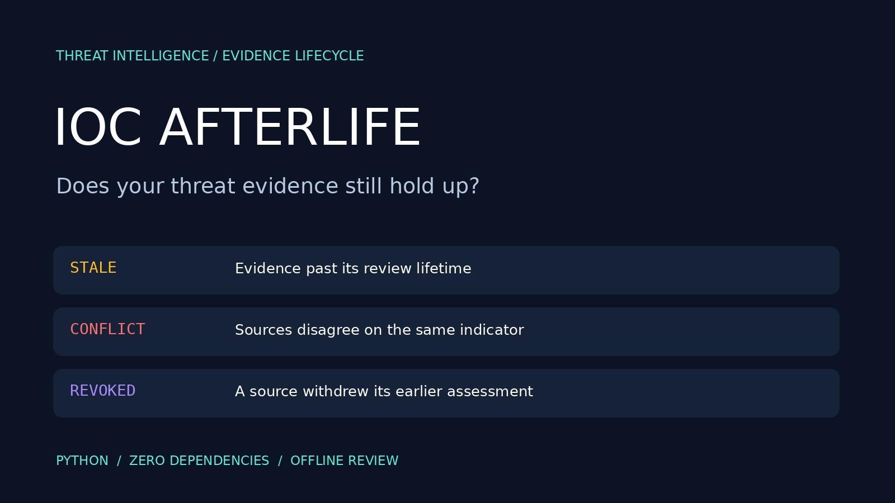
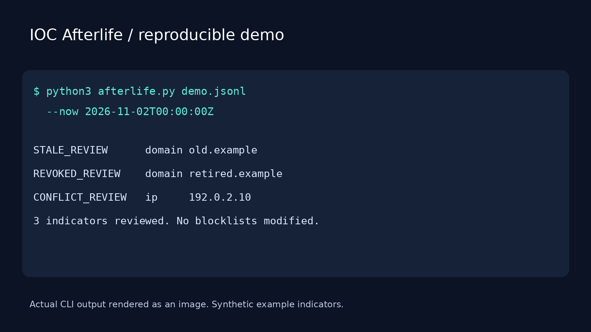

# IOC Afterlife




**Your threat indicators have a past. Should they still shape your defenses?**

IOC Afterlife is a small, offline evidence-lifecycle reviewer for threat intelligence. Feed it dated assessments and it surfaces stale intelligence, source disagreements, and withdrawn assessments before they become forgotten operational assumptions.

## Why this project?

The design focuses on **when and why an indicator should be reviewed**, with an evidence trail for each decision. It does not claim to discover malicious infrastructure or to be the first tool in this category. It is a focused prototype suitable for a CTI portfolio, research demo, or integration into a review pipeline.

## Features

- IPv4/IPv6, IDNA domain, and SHA256 normalization.
- Explicit per-record expiry or configurable fallback lifetime.
- Latest assessment per source supersedes that source's older evidence.
- Equal-time contradictory assessments remain visible as conflicts.
- Cross-source disagreements require review; no automatic majority vote.
- Readable terminal output and structured JSON evidence reports.
- Deterministic historical evaluation with `--now`.
- Zero third-party dependencies, network calls, or blocklist mutations.

## Installation

Install Python 3.10 or newer. Extract this repository, open a terminal in its directory, then run:

```bash
python3 afterlife.py --help
```

Windows: substitute `py -3` for `python3` if needed. No pip installation is required.

## Quick start

```bash
python3 afterlife.py demo.jsonl --now 2026-11-02T00:00:00Z
```

Output:

```text
STALE_REVIEW      domain old.example
REVOKED_REVIEW    domain retired.example
CONFLICT_REVIEW   ip     192.0.2.10
3 indicators reviewed. No blocklists modified.
```

Save full evidence for another pipeline:

```bash
python3 afterlife.py demo.jsonl --now 2026-11-02T00:00:00Z --json > report.json
python3 afterlife.py demo.jsonl --ttl-days 14
```

Without `--now`, the current UTC time is used. Demo results therefore change over time.

## Input format

UTF-8 JSONL: one JSON object per line; blank lines are ignored.

```json
{"type":"domain","value":"suspicious.example","source":"feed-a","verdict":"malicious","observed_at":"2026-11-01T00:00:00Z","valid_until":"2026-11-08T00:00:00Z"}
```

| Field | Meaning |
| --- | --- |
| `type` | `ip`, `domain`, or `sha256` |
| `value` | Indicator; defanged values must first be converted by the caller |
| `source` | Stable, nonempty assessment-source identifier |
| `verdict` | `malicious`, `benign`, or `revoked` |
| `observed_at` | Assessment timestamp with timezone, not ingestion time |
| `valid_until` | Optional expiry timestamp with timezone |

`revoked` means this source has withdrawn its assessment; it does not establish that the indicator is safe. A later record from a source replaces only that source's older record. At the exact expiry boundary evidence is stale. Without explicit expiry, the fallback TTL applies from `observed_at`. Future observations and expiry before observation are rejected. Use a fixed evaluation time for historical datasets.

## Decision rules

Only fresh, non-superseded evidence contributes to the status:

| Evidence | Status |
| --- | --- |
| More than one distinct verdict | `CONFLICT_REVIEW` |
| Malicious only | `ACTIVE_REVIEW` |
| Benign only | `BENIGN_REVIEW` |
| Withdrawn only | `REVOKED_REVIEW` |
| None remains fresh | `STALE_REVIEW` |

JSON output includes evaluation time, indicator status, source, verdict, age in days, staleness and supersession flags. It retains original evidence order within each indicator and sorts indicators for stable output. Exit code is 0 for successful analysis, including findings, or 2 for invalid input / file errors.

## Validation

```bash
python3 -m unittest discover -v
```

Eight tests cover disagreement, source supersession, expiration, expiry boundaries, tied conflicts, future dates, timezone validation and normalization.

## Limits

This is a heuristic evidence reviewer, not a reputation service. Source identity is supplied by the caller and is not authenticated. Multiple source names may represent the same underlying feed. TTL is an analyst policy, not proof of innocence or danger. No STIX/TAXII import, URL indicators, live DNS, feed fetching, scoring, or automatic allow/block changes are included. Review upstream assessments before operational action. Memory usage grows with input size; stream-partition very large datasets upstream. No claim of search ranking or unique naming is made.

## GitHub publishing kit

Suggested description:

> Offline threat-intelligence evidence review: detect stale IOCs, conflicting verdicts and withdrawn assessments with zero Python dependencies.

Suggested topics:

`cybersecurity`, `threat-intelligence`, `cti`, `ioc`, `blue-team`, `soc`, `threat-hunting`, `python`, `digital-forensics`, `offline`, `security-tools`

Search phrases: IOC expiration, stale threat intelligence, IOC lifecycle, conflicting threat feeds, threat intelligence data quality.

Repository: https://github.com/dxrkf/ioc-afterlife. Use the runnable demo and its actual output in your launch post. Do not market heuristic findings as confirmed threats.

## Visual demo



See [POST.md](POST.md) for launch copy.
